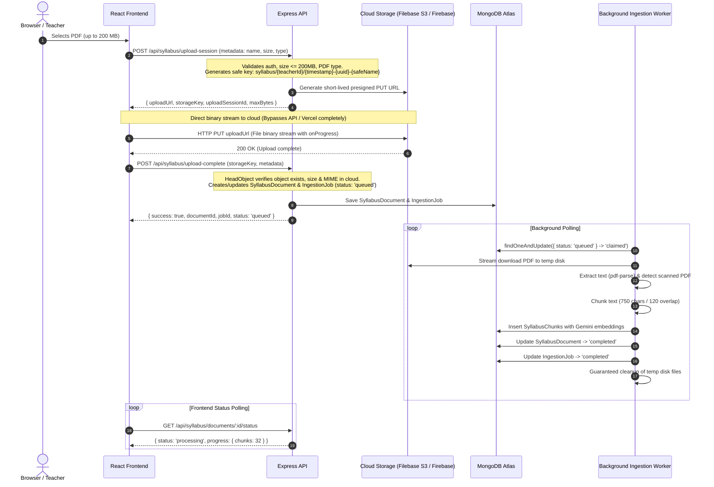

# Neev — Phase 6 Architecture & Ingestion Audit Report

**Audit Date**: October 2026  
**Project**: Neev Platform (React + Vite, Node.js + Express, MongoDB Atlas, Firebase Auth, Filebase S3 / Cloudflare R2 / Firebase Storage, xAI Grok & Gemini RAG)  
**Objective**: Direct-to-cloud PDF upload pipeline and asynchronous background ingestion worker handling files up to **200 MB per file** without routing large payloads through frontend hosting or Vercel API.

---

## 1. What Already Works in the Codebase

### 1.1 Storage Abstraction (`backend/src/services/storage/`)
- **`S3StorageProvider`**:
  - Implements AWS S3 client supporting Filebase (`https://s3.filebase.io`) and Cloudflare R2 (`https://<account_id>.r2.cloudflarestorage.com`) with `forcePathStyle: true`.
  - Implements `saveFile`, `getFileBuffer`, `getFileStream`, `deleteFile`, `getPresignedDownloadUrl`, and `verifyConnection`.
  - Live Filebase S3 connectivity is verified on bucket `neev-project-123456789`.
- **`FirebaseStorageProvider`**:
  - Implements storage operations using `firebase-admin/storage`.
  - Supports authenticated downloads, stream creation, and presigned download URLs.
- **`LocalStorageProvider`**:
  - Provides offline disk storage for development.

### 1.2 Ingestion & RAG Pipeline (`backend/src/services/rag/`)
- **`extractionService.js`**:
  - Uses `pdf-parse` v2 (`PDFParse`) for digital PDFs and `tesseract.js` for image OCR.
  - Detects scanned PDFs (<40 characters of text) and sets `ocr_required`.
- **`chunkingService.js`**:
  - Splits multi-page text into bounded overlapping chunks (750 chars, 120 overlap) preserving page numbers.
- **`embeddingService.js`**:
  - Supports Google Gemini `text-embedding-004` (768 dimensions), OpenAI (1536d), and deterministic offline mock for tests.
  - Strictly rejects mock embeddings in production.
- **`retrievalService.js`**:
  - Enforces strict teacher ownership filtering and transparently reports vector index status.

### 1.3 Teacher Ownership & Authentication
- Authenticated middleware verifies Firebase ID tokens and attaches teacher records.
- All syllabus document endpoints (`/api/syllabus/*`) enforce teacher isolation.

---

## 2. What Is Missing or Incorrectly Connected

### 2.1 Multipart Upload Bottleneck (Critical)
- **Current Behavior**: `syllabusController.js` uses `multer.memoryStorage()` with a synchronous endpoint `POST /api/syllabus/ingest`.
- **Why this fails for 200 MB files**:
  1. Multer loads the full 200 MB into Node.js heap memory, causing memory spikes and possible out-of-memory (OOM) crashes.
  2. Vercel serverless functions have a **4.5 MB request payload limit** and a 10s–60s execution timeout. Routing a 200 MB PDF through Express crashes with `413 Payload Too Large` or Gateway Timeout (`504`).
  3. The client browser hangs waiting for synchronous text extraction, chunking, and batch embedding generation.

### 2.2 Missing Presigned Upload URL & Direct Cloud Upload
- `storageService.js` defines `getPresignedUploadUrl`, but `S3StorageProvider` has not implemented it (`PutObjectCommand` presigned URL).
- No endpoint exists for initiating a direct-to-cloud upload session (`/api/syllabus/upload-session`).
- No endpoint exists to verify cloud object existence and start ingestion (`/api/syllabus/upload-complete`).

### 2.3 R2 Adapter Duplication
- `r2StorageProvider.js` was created as a separate file, but `storageService.js` instantiates `S3StorageProvider` for `r2`.
- Both need unified method signatures and presigned upload support.

### 2.4 Lack of Asynchronous Ingestion Queue & Worker
- Currently, ingestion happens synchronously inside the HTTP handler.
- There is no background worker (`backend/src/workers/ingestionWorker.js`) or persistent MongoDB-backed job queue model (`IngestionJob.js`).
- If an HTTP request disconnects, ingestion is terminated midway, leaving orphaned documents.

### 2.5 Frontend Ingestion UX
- `frontend/src/sections/ClassSyllabus.jsx` uploads directly via `FormData` to `/api/syllabus/ingest` with no upload progress bar, no resumable direct-to-cloud upload, and no polling for background job completion.

### 2.6 Environment Variable Mismatch
- `backend/.env.example` lists `FILEBASE_ENDPOINT=https://s3.filebase.com`, whereas the verified API endpoint used by the project and provider is `https://s3.filebase.io`.

---

## 3. Files Planned to Modify or Add

| File | Status | Planned Changes |
| :--- | :--- | :--- |
| `backend/src/services/storage/s3StorageProvider.js` | **Modify** | Implement `getPresignedUploadUrl` (`PutObjectCommand`), `verifyUploadedObject` (`HeadObjectCommand` to check size & mimeType). |
| `backend/src/services/storage/firebaseStorageProvider.js` | **Modify** | Implement `getPresignedUploadUrl` (`file.getSignedUrl({ action: 'write' })`) and `verifyUploadedObject`. |
| `backend/src/services/storage/r2StorageProvider.js` | **Modify** | Implement `getPresignedUploadUrl` and `verifyUploadedObject` matching `S3StorageProvider`. |
| `backend/src/services/storage/storageService.js` | **Modify** | Expose `getPresignedUploadUrl`, `verifyUploadedObject`, and `generateStorageKey`. |
| `backend/src/models/IngestionJob.js` | **Create** | MongoDB model for tracking background ingestion jobs with atomic claiming, retry count, and progress. |
| `backend/src/models/SyllabusDocument.js` | **Modify** | Add status enum values (`pending`, `uploaded`, `queued`), reference to active `jobId`, and progress metadata. |
| `backend/src/controllers/syllabusController.js` | **Modify** | Add `createUploadSession`, `completeUploadSession`, `getIngestionJobStatus`, `retryIngestionJob`. |
| `backend/src/routes/syllabus.routes.js` | **Modify** | Register upload session, completion, job status, and retry routes. |
| `backend/src/workers/ingestionWorker.js` | **Create** | Standalone background worker process that claims queued jobs, streams files from cloud storage, extracts text, generates embeddings, and updates progress. |
| `backend/src/services/rag/ingestionService.js` | **Modify** | Decouple extraction/embedding execution to be callable by worker from existing cloud object key. |
| `frontend/src/services/syllabusService.js` | **Modify** | Add direct cloud upload helper with XMLHttpRequest upload progress, upload completion caller, and status poller. |
| `frontend/src/sections/ClassSyllabus.jsx` | **Modify** | Add 200 MB validation, upload progress bar (0–100%), background ingestion status indicator, and retry action. |
| `backend/.env.example` | **Modify** | Correct `FILEBASE_ENDPOINT=https://s3.filebase.io`, add worker concurrency/polling settings. |
| `backend/tests/phase6DirectUploadAndWorker.test.js` | **Create** | Comprehensive 17-test suite verifying direct cloud upload, worker queue, retry limits, and security boundaries. |
| `PHASE_6_IMPLEMENTATION.md` | **Create** | Full deployment and operational documentation. |

---

## 4. How the Implementation Fits into Existing Architecture

### Key Architectural Safeguards:
1. **Zero Large Payloads to Express/Vercel**: Browsers stream large PDFs directly to Filebase S3 or Firebase Storage using signed PUT URLs.
2. **Tenant Isolation**: Cloud keys are strictly prefixed with `syllabus/${teacherId}/`, preventing teachers from claiming or accessing another teacher's storage objects.
3. **Atomic Worker Claiming**: MongoDB `findOneAndUpdate` prevents race conditions when running multiple worker instances.
4. **Idempotent Ingestion**: Chunks are deduplicated and purged before re-indexing, preventing duplicate vectors.
5. **No Fake Results**: Strict error propagation if embeddings fail or if a PDF is scanned.

